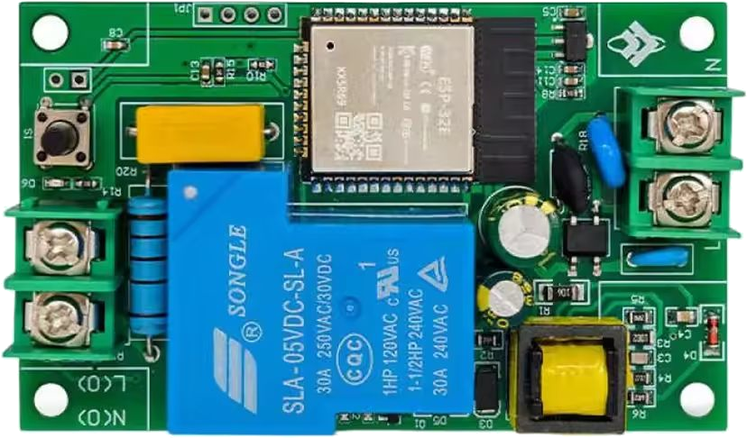

# PowerRelay (ESP32)

ESP32 firmware for controlling a power relay via Web UI, MQTT, hardware button, and optional UART integration.

The device was developed for a Voron 3D printer using an AliExpress <a href="https://he.aliexpress.com/item/1005009205377116.html?spm=a2g0o.detail.0.0.3b71x2qtx2qtfX">board</a>.



## Features

- Wi-Fi STA and fallback AP mode
- Web UI for relay control and settings
- MQTT control/state topics
- Home Assistant MQTT Discovery support
- Optional UART control workflow with delayed OFF
- Physical BOOT button:
  - short press -> relay toggle
  - long press (30s) -> factory reset + reboot
- Task Watchdog (WDT) for firmware main loop supervision

## Hardware

- ESP32 dev board
- Relay module
- USB cable for flashing/power
- 2.4 GHz Wi-Fi

## GPIO mapping

| Pin | Purpose |
|-----|---------|
| GPIO0 | BOOT button (short press toggle, 30s reset) |
| GPIO2 | Relay output |
| GPIO4 | Status LED |

## Runtime behavior

### Wi-Fi modes

- If SSID/password are empty, device starts in AP mode.
- AP fallback address: `192.168.4.1`
- If credentials are set, device starts in STA mode.

### Status LED

- AP mode: solid ON
- STA disconnected: OFF
- STA connected: blink

### UART control (optional)

When **Use UART control** is enabled:

- ON action sends `power_on`
- OFF action sends `power_off`, then firmware waits `uartTimeout` before physically switching relay off
- Incoming UART commands `power_on` / `power_off` are also handled
- During pending OFF delay, MQTT availability is published as `offline` (HA entity becomes temporarily unavailable)

## Build

ESP-IDF version in this project: **6.0.1**

```bash
idf.py build
```

## Flash

```bash
idf.py -p COM3 flash
```

Replace `COM3` with your serial port.

## Web interface

- Main page: `/`
- Settings page: `/settings`

Settings include:

- Wi-Fi SSID/password
- Host name
- MQTT enable/host/port/user/password/base topic
- Home Assistant discovery toggle
- Power enabled by default on startup
- UART control toggle
- UART shutdown delay (seconds)

## MQTT

Base topic is configurable in settings (`mqttBaseTopic`).

Topics:

- `<base>/set` -> commands: `ON`, `OFF`, `TOGGLE` (also `1/0`, `true/false`)
- `<base>/state` -> `ON` / `OFF`
- `<base>/availability` -> `online` / `offline`

## Home Assistant discovery

When enabled, firmware publishes discovery config to:

- `homeassistant/switch/<entity_id>/config`

`entity_id` is derived from MQTT base topic.

## HTTP API

| Endpoint | Method | Description |
|----------|--------|-------------|
| `/status` | GET | Relay state + pending-off info |
| `/api/settings` | GET | Current configuration JSON |
| `/api/settings` | POST | Update configuration |
| `/action?cmd=on` | POST | Toggle relay |
| `/api/reboot` | POST | Reboot device |
| `/api/reset` | POST | Factory reset + reboot |

`/status` response contains:

- `powerOn` (bool)
- `pendingOff` (bool)
- `pendingOffMs` (number)

## Watchdog

Task WDT is initialized in `app_main` and fed in firmware loop:

- timeout: 30s
- panic on timeout: enabled

## Project structure (main parts)

```text
main/
  main.cpp        # app startup, task loop, WDT
  web.cpp         # HTTP server and handlers
  web_page.h      # embedded HTML/JS for UI
  api.cpp         # settings JSON/form processing
  mqtt.cpp        # MQTT + HA discovery
  wifi.cpp        # STA/AP mode logic
  hardware.cpp    # GPIO, LED, BOOT button handling
  uart.cpp        # UART command I/O
  app_state.*     # config/state/timers/NVS
```

## Repository

- Issues: https://github.com/Novakovskiy/PowerRelayESP32/issues
- Releases: https://github.com/Novakovskiy/PowerRelayESP32/releases
